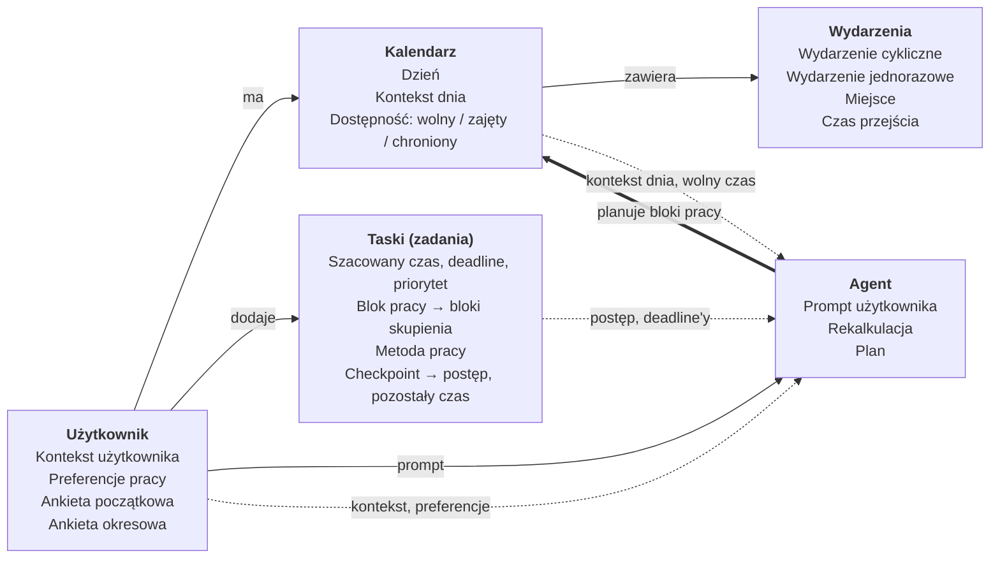

# Słownik domenowy

## Użytkownik

| Pojęcie | Definicja |
|---|---|
| Użytkownik | Osoba, której kalendarz jest w aplikacji |
| Kontekst użytkownika | Długoterminowe informacje o użytkowniku: co lubi i czego nie (np. praca w bibliotece), cele (np. trening 3 razy w tygodniu i jakiego rodzaju), nawyki. Uzupełniany przez ankiety okresowe |
| Preferencje pracy | Część kontekstu użytkownika opisująca sposób pracy: długość bloku skupienia, metoda pracy, preferowane pory dnia. Ustalane w ankiecie początkowej |
| Ankieta początkowa | Pytania zadawane przy pierwszym uruchomieniu aplikacji, ustalające preferencje pracy użytkownika |
| Ankieta okresowa | Cykliczne pytania do użytkownika o to, co chciałby zmienić lub dodać. Aktualizuje kontekst użytkownika |

## Kalendarz

| Pojęcie | Definicja |
|---|---|
| Kalendarz | Zbiór wszystkich wydarzeń i bloków pracy użytkownika w czasie |
| Dzień | Jednostka kalendarza, do której przypisany jest kontekst dnia |
| Kontekst dnia | Bieżące informacje o danym dniu: pogoda, temperatura, aktywność fizyczna, jakość snu, samopoczucie |
| Dostępność | Stan przedziału czasu w kalendarzu: wolny, zajęty albo chroniony |
| Wolny | Dostępność, w której agent może planować bloki pracy |
| Zajęty | Dostępność przedziału, w którym trwa wydarzenie lub blok pracy |
| Chroniony | Dostępność przedziału, którego agent nie może używać do planowania pracy (np. sen, święta). Ustalany przez agenta na podstawie kontekstu użytkownika i kontekstu dnia albo wskazany przez użytkownika |

## Wydarzenia

| Pojęcie | Definicja |
|---|---|
| Wydarzenie | Zobowiązanie użytkownika o określonej godzinie rozpoczęcia, czasie trwania i miejscu |
| Wydarzenie cykliczne | Wydarzenie powtarzające się według reguły (np. co tydzień we wtorek) |
| Wydarzenie jednorazowe | Wydarzenie występujące tylko raz |
| Miejsce | Lokalizacja wydarzenia lub bloku pracy |
| Czas przejścia (czas buforowy) | Czas potrzebny na dojazd lub przygotowanie przed wydarzeniem lub blokiem pracy. Liczony na podstawie miejsca poprzedniej i bieżącej aktywności |

## Taski (zadania)

| Pojęcie | Definicja |
|---|---|
| Task (zadanie) | Czynność do wykonania przez użytkownika, zdefiniowana przez szacowany czas, deadline i priorytet. W przeciwieństwie do wydarzenia nie ma z góry narzuconej godziny realizacji |
| Szacowany czas | Łączny czas potrzebny na ukończenie taska, podany przez użytkownika |
| Deadline (termin) | Moment, przed którym task musi być ukończony |
| Priorytet | Waga taska wpływająca na kolejność i porę planowania bloków pracy |
| Blok pracy | Zaplanowany przez agenta przedział czasu przeznaczony na realizację części taska. Dzieli się na bloki skupienia |
| Blok skupienia | Nieprzerwany odcinek pracy wewnątrz bloku pracy, o długości wynikającej z preferencji pracy |
| Metoda pracy | Sposób podziału bloku pracy na bloki skupienia i przerwy (np. Pomodoro) |
| Checkpoint | Punkt kontrolny po zakończeniu bloku pracy, w którym użytkownik potwierdza, ile faktycznie zrobił (całość, część, nic) i opcjonalnie koryguje szacowany czas |
| Postęp taska | Stan realizacji taska wynikający z kolejnych checkpointów: czas już przepracowany i pozostały czas |
| Pozostały czas | Szacowany czas taska pomniejszony o przepracowany czas. Na jego podstawie agent planuje kolejne bloki pracy |

## Agent

| Pojęcie | Definicja |
|---|---|
| Agent | Komponent planujący bloki pracy w czasie wolnym na podstawie tasków, wydarzeń, kontekstu użytkownika i kontekstu dnia |
| Prompt użytkownika | Wiadomość w języku naturalnym od użytkownika do agenta (np. „nie mam dziś siły”, „przesuń naukę na wieczór”). Agent na jej podstawie aktualizuje kontekst dnia lub kalendarz i może wywołać rekalkulację |
| Rekalkulacja | Ponowne ułożenie bloków pracy po zmianie w kalendarzu, kontekście dnia, taskach, postępie taska lub po prompcie użytkownika. Jeśli plan nie istnieje, agent proponuje zmianę lub ją odradza |
| Plan | Układ kalendarza, w którym wszystkie deadline'y są dotrzymane, a wydarzenia użytkownika pozostają niezmienione |

## Model domenowy

